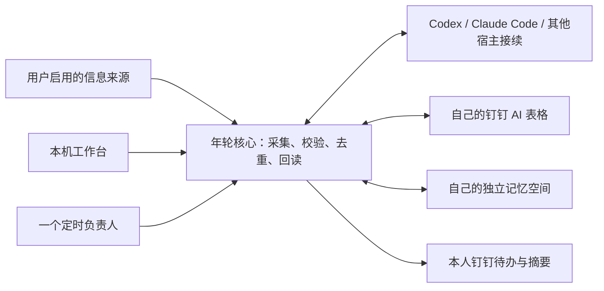

# 年轮 · Nianlun

**让 AI 跟着项目往前走：进度持续更新，里程碑自动倒排，汇报自然生成。**

年轮是一套可接入不同 AI 宿主的本地项目管理工具。它通过 DWS CLI 连接你自己的钉钉 AI 表格，用独立记忆空间保存长期记忆，由已登录的 AI 宿主分析信息。界面、采集、去重和写后核验由年轮负责。

代码采用 [Apache-2.0](LICENSE) 许可证。当前为 **2.2.0 发布候选版**；各平台的验证范围见下表。

## 能做什么

- **建立工作空间**：安装依赖，连接钉钉，初始化项目、里程碑、场地、项目记录四张子表，或映射已有表格。
- **接续项目记忆**：归集用户选择的听记、消息和人类会话，结合项目历史记忆，保留原文引用与来源。
- **自动生长**：按配置时间采集，写项目进度，创建或完成本人待办，推送摘要，生成阶段汇报并回填链接。
- **更换 AI 宿主**：核心与宿主分开安装；换宿主保留表格、记忆和执行回执。AI 宿主、定时负责人、信息来源分别选择。



## 2.2 工作台迭代

项目关系树与桑基关联视图、记录状态快改、待办批量完成、项目记忆图谱、递归能力目录选择、任务进度与通知已接入。DWS 复用已有系统代理，编辑只回读目标记录；DeepSeek 保留清楚可恢复的宿主接续。CDBI 场地来源支持组织分发包接入。详见 [2.2 发布说明](docs/PRODUCT_RELEASE_2.2.md) 和 [验收范围](docs/VALIDATION_2.2.md)。

## 2.1.1 修复

本次修复运行状态、暂停和故障恢复：页面回读宿主原生调度状态，立即暂停无需等待写入队列；未知写入先核验原结果，再继续原轮次剩余步骤；相同失败不重复通知。项目工作台、规划和汇报共用活跃项目口径。验证范围见 [2.1.1 验收记录](docs/VALIDATION_2.1.1.md)。

## 2.1 增量

- 定时与手动采集共用一条生长链；手动可选时间、渠道和项目。增加明确选定的群聊与邮箱来源。
- 根据目标与目标日期自动倒排里程碑；保留人工节点、人工修改及已完成节点。
- 自动维护各项目的连续记忆；手动、定时和生长后汇报共用事实与记忆分析逻辑。
- 汇报生成后可预览并选择项目群，通过 DWS CLI 发送并核验投递；支持按月选择范围。
- 能力中心支持多个自选 Skill 目录；丰声待办完成状态继续双向回写并验证。

详细步骤见 [产品使用说明书](docs/USER_GUIDE.md)，功能说明见 [2.2 产品发布说明书](docs/PRODUCT_RELEASE_2.2.md)，[2.1 发布叙事](docs/PRODUCT_RELEASE_2.1.md) 保留归档。[版本规则](docs/VERSIONING.md) 规定大版本用于里程碑，小版本承载增量。新增来源与自动动作默认需在页面开启，升级保留原绑定。

## 安装

2.2 安装包由 `python packaging/build.py` 生成，文件名为 `nianlun-v2.2.0-mac-windows.zip`。已发布版本见 [Releases](https://github.com/BetterZflyee/nianlun/releases)，解压后：

1. Mac 打开 `安装年轮.command`；Windows 打开 `安装年轮.cmd`。
2. 向导会准备个人运行环境、钉钉连接工具和记忆引擎，不要求预装 Python 或记忆工具。
3. 登录自己的钉钉，粘贴 AI 表格链接，检查并初始化或绑定四张子表。
4. 新建或连接独立记忆空间，选择 AI 宿主、信息来源和允许的自动动作。
5. 配置时间和一个定时负责人，在所选宿主中完成原生任务注册与验证。

之后使用 `打开年轮` 启动器。不要直接打开 `nianlun/assets/portal/index.html`：控制台需要本机服务。

也可将安装包交给 AI 宿主，按 [宿主安装说明](packaging/在AI宿主中安装.md) 操作。安装器尚未签名；无需关闭系统防护，受限环境可由具备本地执行能力的宿主运行安装。完整说明见 [使用指南](packaging/使用说明.md)。

## 支持情况

| 环境 | 当前能力 | 验证边界 |
| --- | --- | --- |
| macOS | 安装、向导、工作台和生长闭环 | 已有本机实测；发行版未签名 |
| Windows x64 / ARM64 | 提供安装器、依赖选择和路径实现 | 原生完整安装及业务闭环待验证 |
| Codex | 已登录 CLI 分析、页面工具工作流、原生定时核验 | 已有本机实测 |
| Claude Code | CLI 适配和结构化接续 | 命令与登录已检查；实际推理测试超时，待补验 |
| WorkBuddy / DeepSeek Harness | 通用 Skill / CLI 与结构化接续 | 协议夹具已验证；原生客户端闭环待补验 |

“结构化接续”表示年轮保存请求和证据，由所选宿主分析，再由年轮继续校验、执行和回读。它不等于已经安装官方连接器，也不等于该宿主的周期任务已经注册。详见 [宿主契约](nianlun/references/host-contract.md) 与 [验收说明](packaging/验收说明.md)。

## 数据与权限

项目事实在你自己的 AI 表格，长期记忆在你自己的独立记忆空间。本机另存连接配置、采集证据、生成文件、游标和去重回执，这些内容可能含私人工作资料。不要把个人运行目录上传到 GitHub。

核心只监听 `127.0.0.1`，API 使用本次会话令牌并检查请求来源。年轮不修改宿主全局权限、系统提示或 MCP 配置。分析会把启用来源中的相关证据交给所选 AI 宿主，数据处理也受该宿主的设置影响。

飞书妙记是可选来源，默认关闭，需要用户自行安装并登录 lark-cli。当前只采集本人拥有的妙记。消息采集不保证覆盖所有聊天、邮件或文档；扫描不完整时保留缺口。已有旧定时写入器须先停用并核验，再迁移到统一控制器。

## 开发与维护

源码按运行核心、界面、安装接入和工程维护分类，入口与职责见 [程序目录说明](docs/PROGRAM_MAP.md)。

当前记忆引擎采用 GBrain，由安装器管理；“独立记忆空间”是面向用户的能力名称。已有空间的兼容范围见 [记忆空间说明](nianlun/references/memory-space.md)，组件来源见 [第三方声明](THIRD_PARTY_NOTICES.md)。

开发使用 Python **3.11+**；安装器提供自己的 Python 3.12 环境。Windows 源码开发需安装 `tzdata`，测试环境统一安装 `requirements-dev.txt`。核心不需要 Web 框架或数据库。

```sh
python -m pip install -r requirements-dev.txt
python -m unittest discover -s nianlun/scripts -p 'test_*.py'
python -m unittest discover -s tools -p 'test_*.py'
python tools/release_guard.py --tracked
python packaging/build.py
```

测试使用模拟云端与临时目录，不要求钉钉账号，不触发真实自动生长。构建输出位于 `deliverables/`，不会加入版本控制。

问题和建议通过 [GitHub Issues](https://github.com/BetterZflyee/nianlun/issues) 提交。待完善事项及验收标准见 [维护路线](docs/ROADMAP.md)；参与修改见 [贡献说明](CONTRIBUTING.md)，发版见 [发布流程](docs/RELEASING.md)。CI 检查每次推送和 PR，不会代替真人账户的集成验收。
